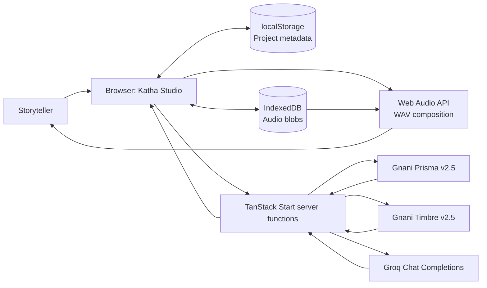
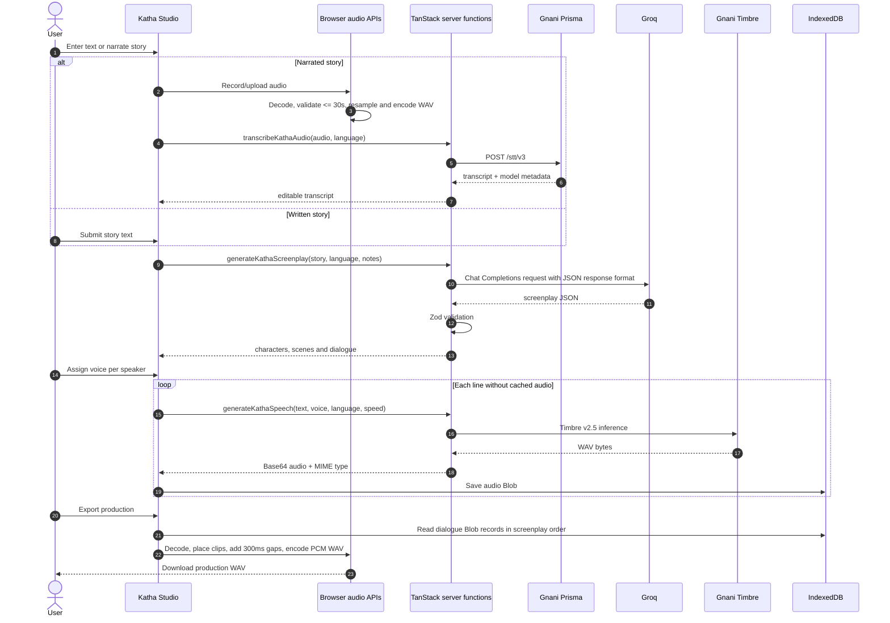
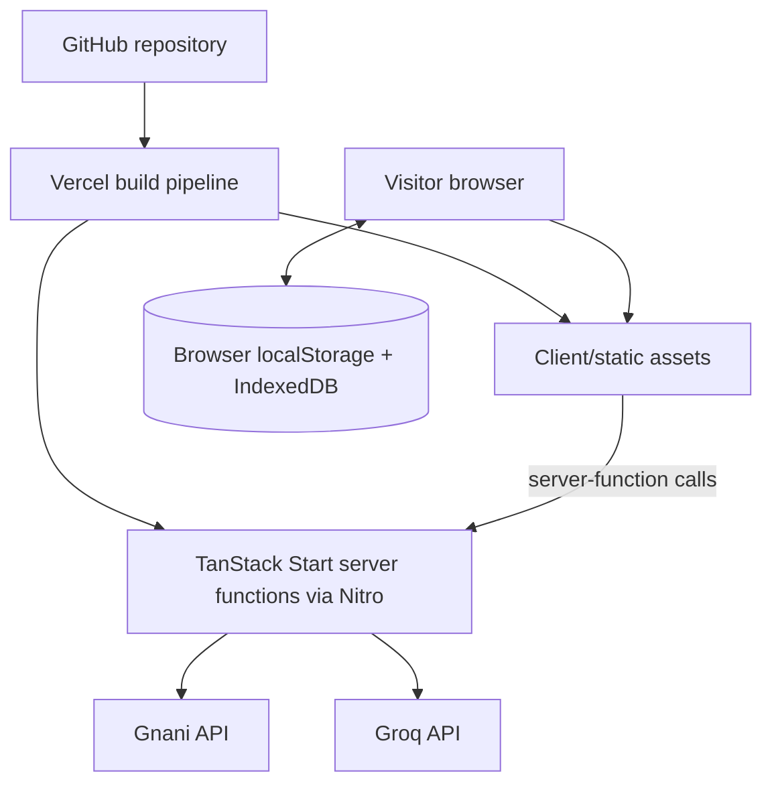

# Katha Studio — Architecture Notes

This document describes the implementation represented by the repository snapshot. It is intentionally explicit about the current browser-local persistence model and the future deployment target.

## Runtime components

| Component | Responsibility | Location |
|---|---|---|
| KathaWorkspace | Dashboard, story input, screenplay, casting, voice library, studio, published and settings screens | `src/components/katha/KathaWorkspace.tsx` |
| Katha server functions | Prisma STT, Timbre TTS, Groq screenplay generation and provider health checks | `src/lib/katha.functions.ts` |
| Voice catalogue | Timbre v2.5 voice metadata and language-specific sample lines | `src/lib/katha/voices.ts` |
| Audio utilities | Duration validation, browser-side audio normalization, PCM WAV encoding and duration formatting | `src/lib/katha/audio.ts` |
| Audio persistence | IndexedDB blob storage helpers | `src/lib/katha/storage.ts` |
| TanStack routes | Route-to-workspace page mapping | `src/routes/` |
| Root/start/server | Query provider, SSR shell, CSRF/error middleware and server entry | `src/routes/__root.tsx`, `src/start.ts`, `src/server.ts` |

## System context



## Story production sequence



## Persistence model

```mermaid
flowchart TB
    PROJECT[StudioProject] --> LS[(localStorage)]
    LS --> STORAGEKEY[katha-studio-projects-v1]
    PROJECT --> SCENES[StudioScene[]]
    SCENES --> LINES[StudioLine[]]
    LINES --> ASSETREF[ audioAssetId ]
    PROJECT --> SOURCE[storyAudioAssetId]
    PROJECT --> FINAL[audioAssetId]
    ASSETREF --> IDB[(IndexedDB)]
    SOURCE --> IDB
    FINAL --> IDB
    IDB --> DBNAME[katha-studio-assets]
    DBNAME --> STORE[audio-assets object store]
    STORE --> BLOB[StoredAudio: id, blob, name, type, createdAt]
```

A project's JSON metadata is stored under `katha-studio-projects-v1`. Audio bytes are stored in IndexedDB under database `katha-studio-assets`, object store `audio-assets`. The project references audio by asset ID. A temporary object URL is created when audio is loaded for playback.

## External API boundaries

### Gnani Prisma

- Server function: `transcribeKathaAudio`.
- Endpoint: `https://api.vachana.ai/stt/v3`.
- Authentication header: `X-API-Key-ID`.
- Request: multipart form data containing `audio_file` and `language_code`.
- Response check: transcript string and `model === "prisma-v2.5"`.

### Gnani Timbre

- Server function: `generateKathaSpeech`.
- Endpoint: `https://api.vachana.ai/api/v1/tts/inference`.
- Authentication header: `X-API-Key-ID`.
- Model: `timbre-v2.5`.
- Inputs: text, voice, preferred/requested language and speed (0.85–1.15).
- Output: WAV audio bytes returned to the browser as Base64 and saved to IndexedDB.

### Groq

- Server function: `generateKathaScreenplay`.
- Endpoint: `https://api.groq.com/openai/v1/chat/completions`.
- Authentication: Bearer token.
- Response mode: JSON object.
- Validation: Zod schema with bounded title, synopsis, characters, scenes and lines.

## Deployment topology



The application source currently uses `@lovable.dev/vite-tanstack-config` in `vite.config.ts`. The comments in that file describe a Cloudflare-default Nitro target. Vercel deployment requires replacing/adapting that Lovable-specific Vite configuration to the supported TanStack Start + Nitro Vercel setup. See the Vercel deployment guide linked from the root README.

## Current persistence boundary

There is no database connection or Supabase package in the current source. The browser storage model is suitable for a single-browser prototype, not a shared multi-user production service. A cloud-backed version should introduce:

1. Authentication and user identity.
2. PostgreSQL tables for projects, characters, scenes, lines and asset metadata.
3. Private object storage for recordings, line audio and exports.
4. Row-level security / ownership checks.
5. Local data migration from localStorage and IndexedDB.
6. Signed downloads or authenticated file access.
