# Katha Studio

> **Your imagination. A full cast. One studio.**
>
> An oral-first, multilingual audio-story production workspace powered by **Gnani AI Prisma**, **Gnani AI Timbre**, and **Groq**.

Katha Studio helps a creator turn a written story or spoken narration into an editable screenplay, assign individual voices to its speakers, generate dialogue audio, arrange the clips, and export a combined production.

<p align="center">
  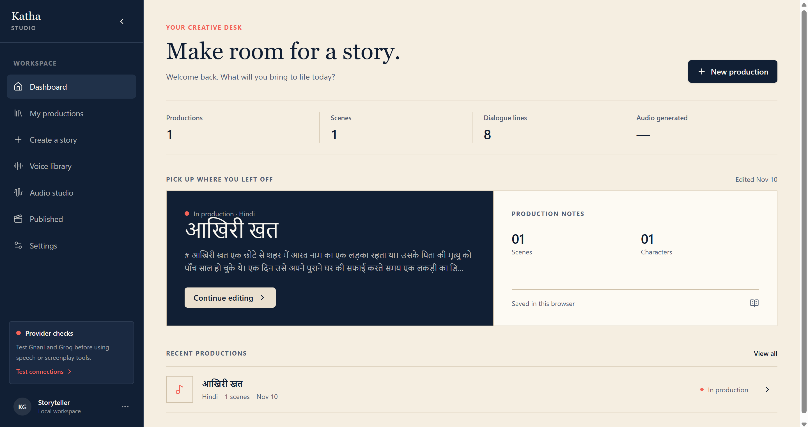
</p>

<p align="center">
  
  
  
  
  
  
</p>

---

## Table of contents

- [What Katha Studio does](#what-katha-studio-does)
- [Current implementation status](#current-implementation-status)
- [Product workflow](#product-workflow)
- [Features](#features)
- [Screenshots](#screenshots)
- [Technology stack](#technology-stack)
- [Architecture](#architecture)
- [AI provider integrations](#ai-provider-integrations)
- [Languages and voice catalogue](#languages-and-voice-catalogue)
- [Local data and file storage](#local-data-and-file-storage)
- [Project structure](#project-structure)
- [Getting started](#getting-started)
- [Environment variables](#environment-variables)
- [Run tests and production build](#run-tests-and-production-build)
- [Deploy to Vercel](#deploy-to-vercel)
- [Security notes](#security-notes)
- [Contributing](#contributing)

---

## What Katha Studio does

Katha Studio is a voice-first creative production tool. A creator can:

1. Write a story or record/narrate it.
2. Transcribe a narration with Gnani Prisma v2.5.
3. Send the story to Groq for structured screenplay extraction.
4. Review and edit the extracted scenes and dialogue.
5. Assign a different Gnani Timbre v2.5 voice to each detected speaker.
6. Generate speech for individual dialogue lines.
7. Preview the generated clips and arrange them in story order.
8. Export the combined production as a WAV file.

The product is designed around a simple principle: **Gnani handles the speech experience; Katha Studio provides the specialized storytelling and audio-production workflow around it.** Groq is used for screenplay structuring, not for speech generation.

## Current implementation status

This README documents the source code in this repository snapshot. It distinguishes implemented functionality from planned cloud features.

| Area | Current state | Notes |
|---|---|---|
| Dashboard and navigation | Implemented | TanStack file-based routes render the Katha workspace. |
| Create story | Implemented | Text input, microphone recording, audio upload, language selection and draft creation. |
| Prisma transcription | Implemented in server functions | Sends the selected audio to Gnani; the current client-side normalization enforces a 30-second clip limit. |
| Groq screenplay extraction | Implemented in server functions | Requests JSON output, validates it with Zod, and returns scenes, speakers and dialogue. |
| Screenplay editing | Implemented | Add/edit/remove dialogue, add/delete scenes, rename the project and export screenplay Markdown. |
| Character voice casting | Implemented | The casting list is derived from speaker names in screenplay lines; voice assignments are stored per speaker in the local project. |
| Voice Library | Implemented | Uses a source-code catalogue of 42 Timbre v2.5 voices and language-specific preview text. |
| Timbre speech generation | Implemented in server functions | Generates WAV audio for voice previews and dialogue lines. |
| Audio playback and project timeline | Implemented | Select and play generated clips, inspect dialogue and regenerate a selected line. The timeline is an ordered clip layout, not a full digital-audio-workstation waveform editor. |
| Combined audio export | Implemented | Browser Web Audio API combines clips in order and exports a PCM WAV file. |
| Published page | Partial | Displays projects whose status is `Published`; a complete public publishing and sharing workflow is not implemented in this snapshot. |
| Supabase database and Storage | Not connected in this snapshot | The uploaded source contains no Supabase SDK integration or Supabase migrations. |
| User accounts and cross-device sync | Not implemented | Project metadata and audio assets are currently browser-local. |

> **Storage clarification:** A Supabase project may exist outside this repository, but this source snapshot does not connect to it. Do not assume that project data or generated audio is backed up to Supabase until a Supabase integration is added and verified.

## Product workflow

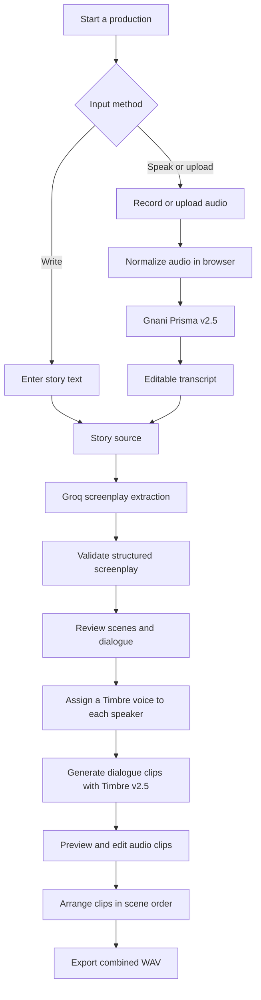

## Features

### 1. Story creation

- Two creation modes: **Write a story** and **Tell it aloud**.
- Story title, source text, language and optional genre/character notes.
- Browser microphone recording with pause, resume and stop controls.
- Upload an existing audio recording.
- Preview the recorded or uploaded audio before saving.
- Drafts are created locally and opened in the storyboard route.

### 2. Speech-to-text with Gnani Prisma v2.5

- Sends the selected recording to the Gnani STT endpoint through a TanStack Start server function.
- Uses the selected story language as the transcription language.
- Converts accepted browser audio to mono, 48 kHz PCM WAV before transcription.
- Returns an editable transcript to the story workflow.
- Handles missing credentials, unsupported requests, provider errors and request timeouts with user-facing messages.

The current implementation checks the documented 30-second Prisma v2.5 duration limit. Longer audio must be split into clips before transcription; automatic long-recording chunk orchestration is not currently implemented.

### 3. AI screenplay extraction with Groq

Groq receives the story text and requested language and is instructed to return a structured screenplay containing:

- Story title and synopsis.
- Characters with IDs, names, roles and descriptions.
- Scenes with stable order values.
- Dialogue/narration lines with speaker IDs and line order.

The response is parsed as JSON and validated against a Zod schema before the application uses it. The source story is retained if generation fails validation.

### 4. Storyboard editor

- Review and edit story text and generated dialogue.
- Add and remove scenes.
- Rename scenes.
- Add dialogue and select a speaker.
- Create a new speaker manually.
- Delete individual dialogue lines.
- Export the screenplay as Markdown.
- Navigate to the casting room for voice assignment.

### 5. Character casting room

- Builds a speaker list from the screenplay's dialogue lines.
- Assigns a Timbre voice independently to each speaker.
- Filters available catalogue voices by the production language when matching voices exist.
- Provides a voice preview using the selected voice's preferred language.
- Allows a voice assignment to be locked or unlocked.
- Stores voice assignments in the local project object.
- Generates missing dialogue audio sequentially, avoiding an unrestricted burst of TTS requests.

**Important implementation detail:** In this source snapshot, the casting UI derives characters from distinct speaker names in scene lines. The LLM's separate character descriptions/roles are validated in the screenplay response, but the project model currently stores the speaker names and voice assignments rather than a complete editable character entity model.

### 6. Voice Library

- Browse a code-defined catalogue of 42 Timbre v2.5 voices.
- Filter by preferred language.
- Display voice name, language, gender metadata and persona label.
- Generate real voice previews through Gnani Timbre.
- Use a sample sentence written in the voice's own preferred language rather than a single English sentence for every voice.

### 7. Audio Studio and export

- Browse scenes and dialogue lines.
- Select a line and inspect its text, speaker and assigned voice.
- Play generated line audio.
- Edit a line and regenerate its audio.
- Adjust speech speed within the range accepted by the server validator (0.85–1.15).
- Arrange the generated clips in screenplay order.
- Combine generated clips in the browser with a 300 ms pause between lines.
- Export a combined mono PCM WAV file at 48 kHz.

The current export pipeline uses the browser **Web Audio API** and a PCM WAV encoder in `src/lib/katha/audio.ts`. It does not use FFmpeg, and the completed export in this snapshot is WAV rather than MP3.

## Screenshots

The screenshots below are the supplied Katha Studio application captures. All 14 original captures are included under [`docs/assets/screenshots/`](docs/assets/screenshots/).

### Dashboard and project library

<p>
  
  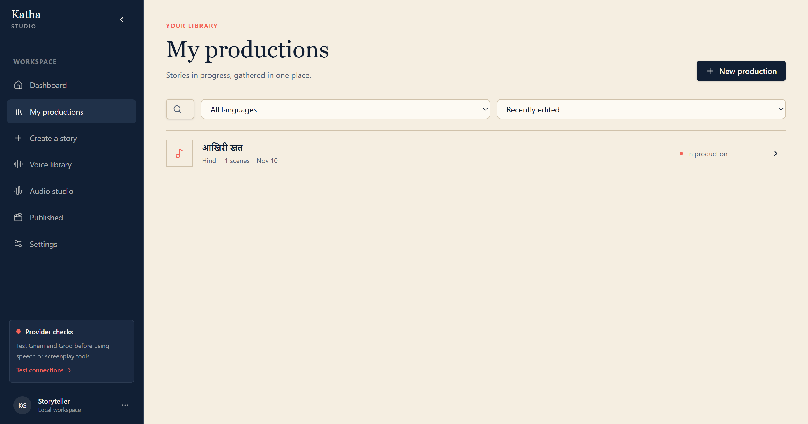
</p>

### Story creation and narration

<p>
  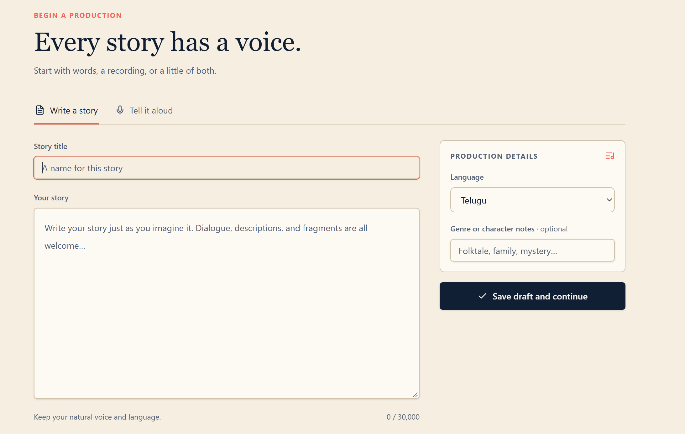
  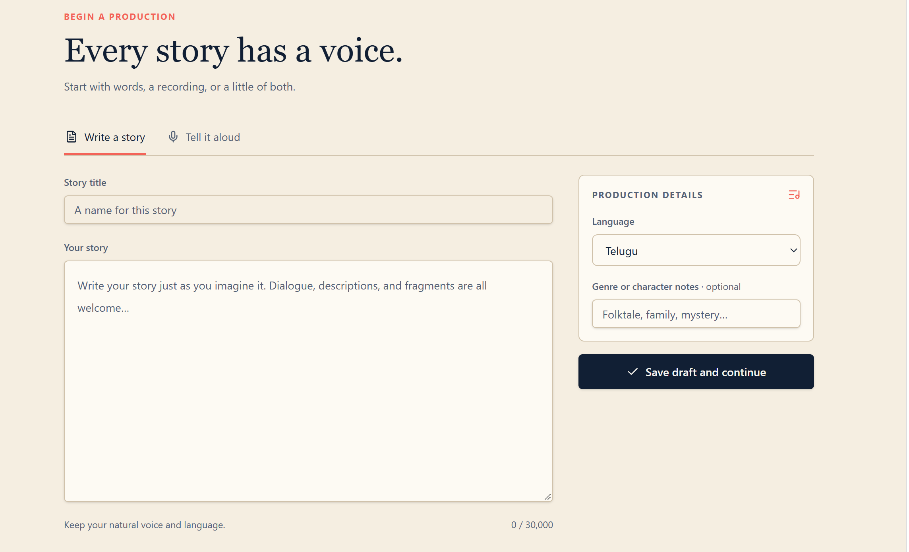
</p>
<p>
  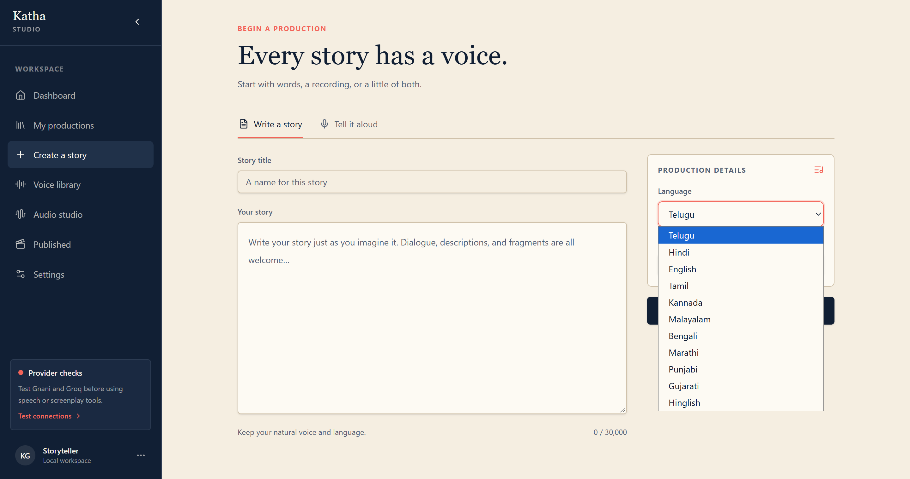
  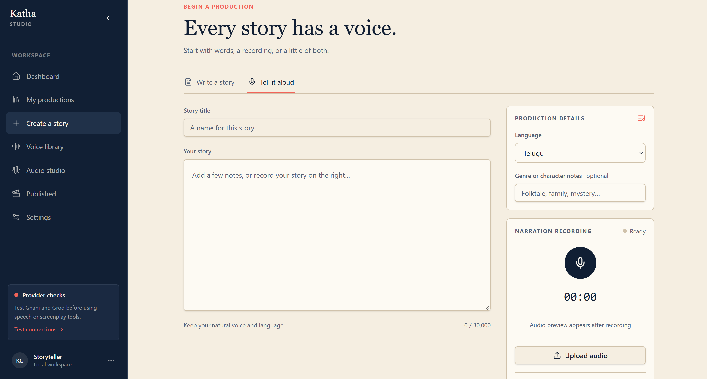
</p>

### Voice Library and language-specific previews

<p>
  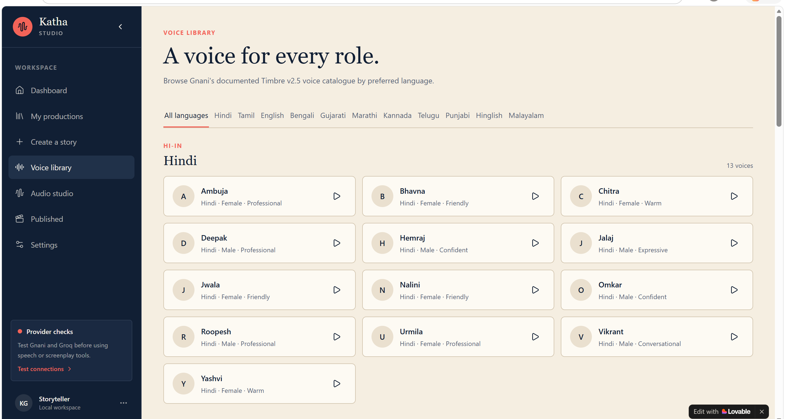
  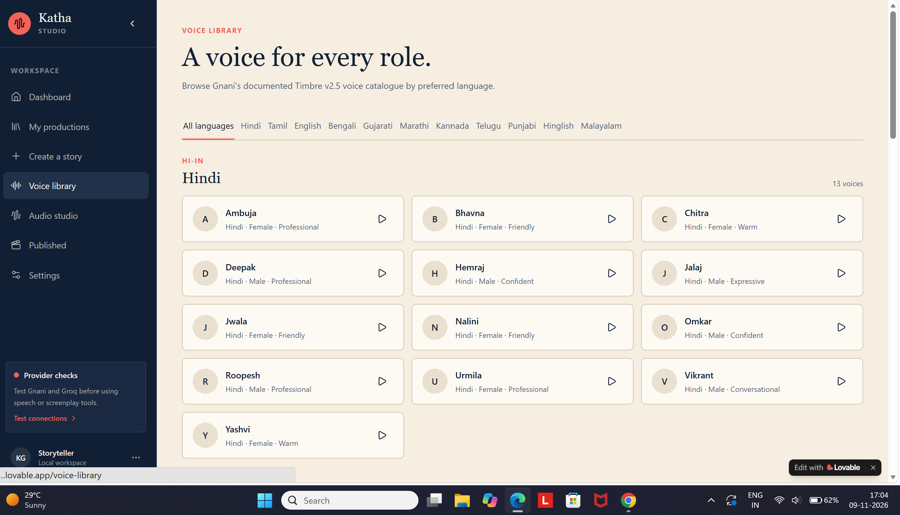
</p>
<p>
  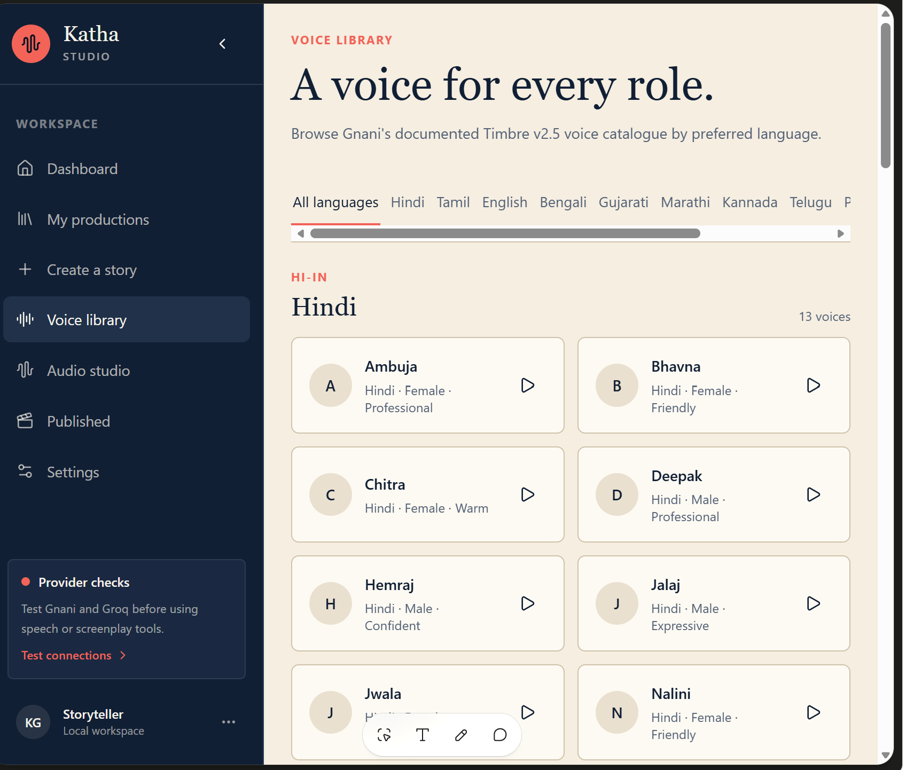
  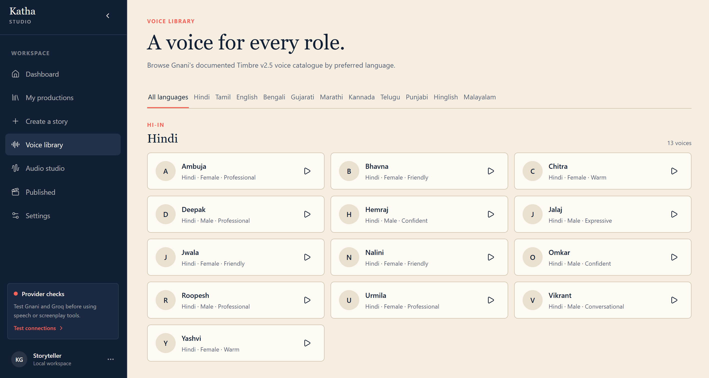
</p>

### Casting and audio production

<p>
  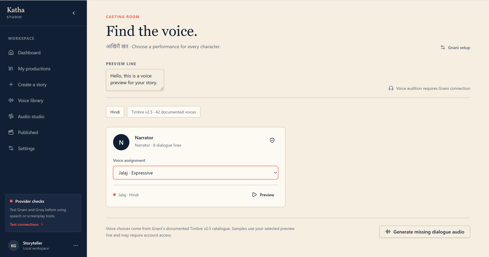
  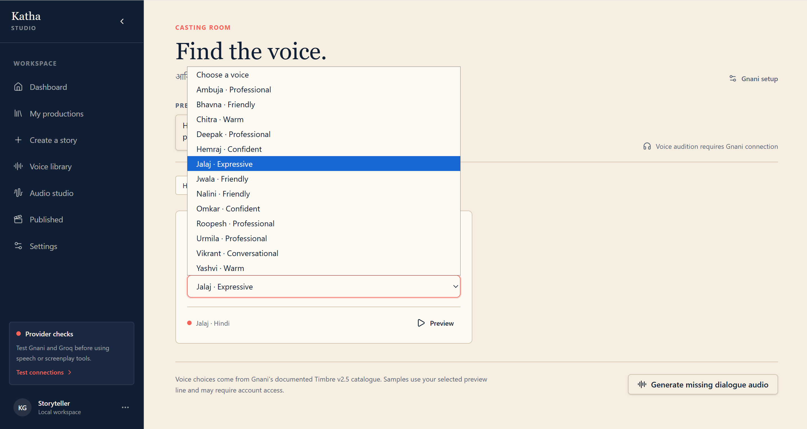
</p>
<p>
  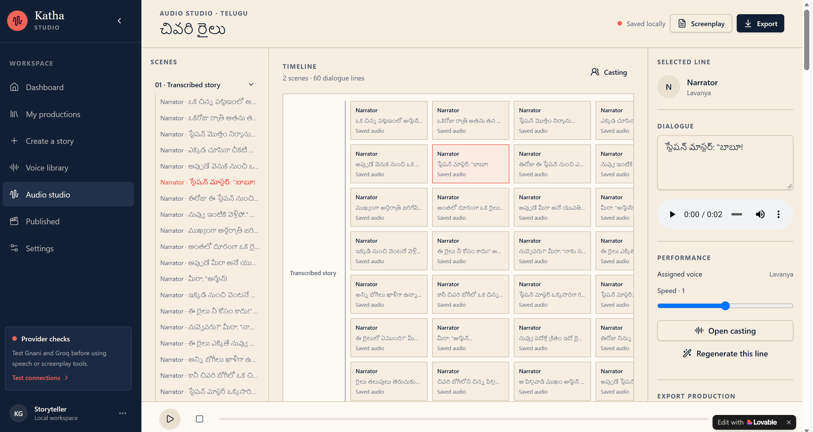
  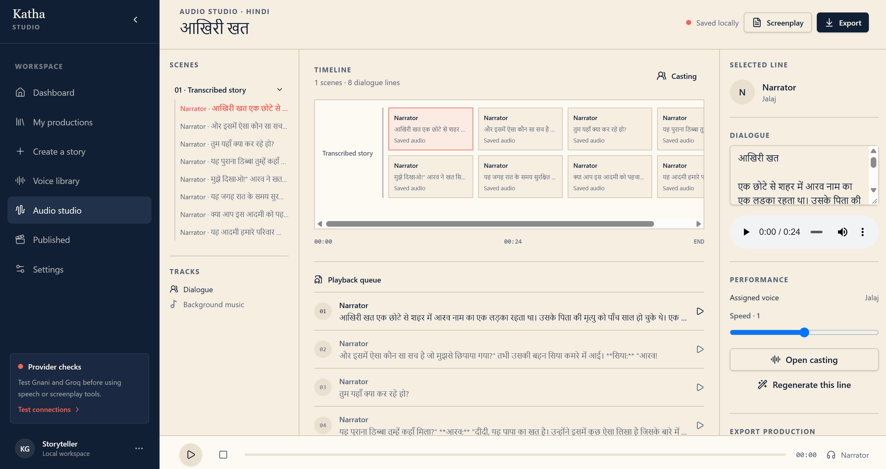
</p>

## Technology stack

| Layer | Technology | Purpose |
|---|---|---|
| UI | React 19 + TypeScript | Component-based application and typed application state. |
| Full-stack framework | TanStack Start | File-based routing, SSR and server functions. |
| Routing | TanStack Router | Dashboard, project, storyboard, casting, studio, voice library, published and settings routes. |
| Build tool | Vite 8 | Local development and production build. |
| Styling | Tailwind CSS v4 | Utility styling and responsive layout. |
| UI components | shadcn/ui + Radix UI | Accessible buttons, inputs, dialogs, selects and other interface primitives. |
| Data fetching/context | TanStack Query | Root query client provider. |
| Icons | Lucide React | Interface iconography. |
| Validation | Zod | Server-function input validation and screenplay response validation. |
| Speech-to-text | Gnani Prisma v2.5 | Narration transcription. |
| Text-to-speech | Gnani Timbre v2.5 | Voice previews and character dialogue audio. |
| Screenplay intelligence | Groq API | Story-to-screenplay JSON extraction. |
| Browser recording | MediaRecorder API | Record a narrated story. |
| Audio conversion/mixing | Web Audio API | Normalize recording audio, decode generated clips and assemble the WAV export. |
| Local project metadata | localStorage | Save project objects and editing state in the current browser. |
| Local binary audio | IndexedDB | Save original recordings, generated clips and final audio assets in the current browser. |
| Tests | Vitest + Testing Library | Routing, audio constraints, voice catalogue and WAV encoding checks. |

## Architecture

### 1. System architecture

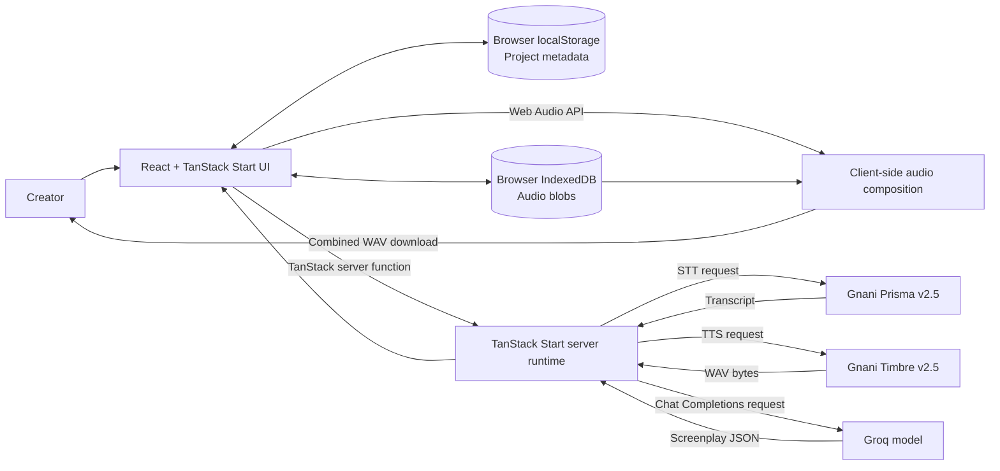

### 2. Voice-story production sequence

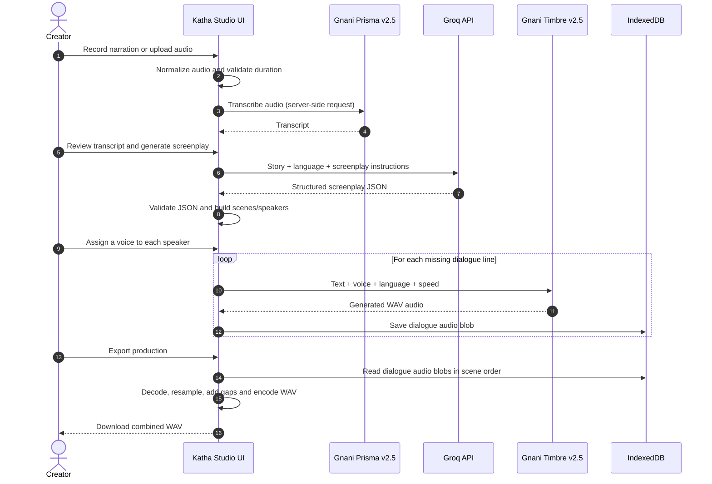

### 3. Local persistence model

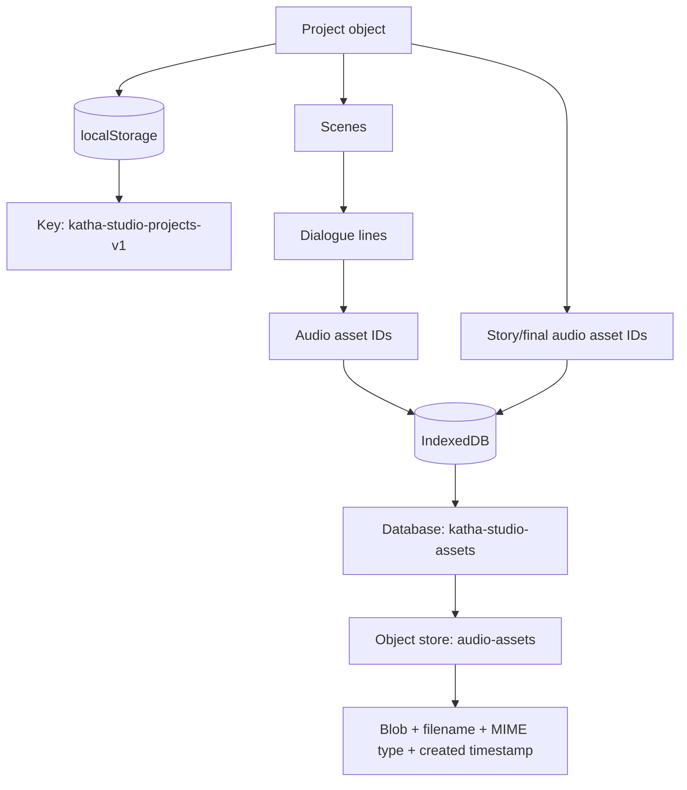

The localStorage project record stores metadata and audio asset IDs. IndexedDB stores the actual audio `Blob` values. Temporary `blob:` URLs are recreated at runtime for playback and are not treated as durable file references.

### 4. Vercel deployment topology (target)

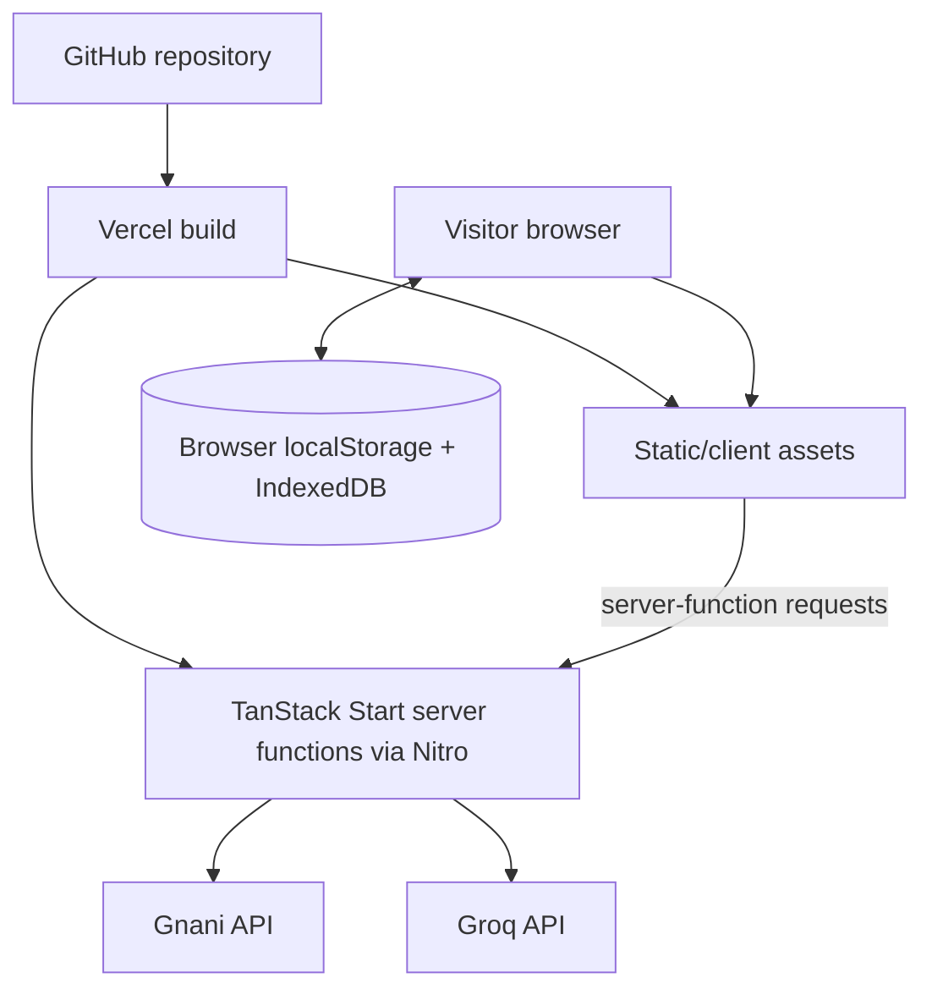

This is the intended hosting topology. **The current exported `vite.config.ts` still uses the Lovable Vite configuration wrapper, whose comments describe a Cloudflare Nitro default.** Complete the Vercel adapter/configuration migration described in [Deploy to Vercel](#deploy-to-vercel) before treating this repository as Vercel-ready.

For additional architecture notes, see [`docs/ARCHITECTURE.md`](docs/ARCHITECTURE.md).

## AI provider integrations

### Gnani AI

The server functions in `src/lib/katha.functions.ts` call Gnani from the server runtime. Credentials are read through `process.env`; they are not embedded in the React bundle.

| Capability | Model | Endpoint used by this repository |
|---|---|---|
| Speech-to-text | Prisma v2.5 | `POST https://api.vachana.ai/stt/v3` |
| Text-to-speech | Timbre v2.5 | `POST https://api.vachana.ai/api/v1/tts/inference` |

The STT request is multipart form data with `audio_file` and `language_code`. The TTS request sends text, voice name, model, language, speed and WAV output configuration. Check the official documentation before changing request fields or model versions:

- [Gnani API quick start](https://docs.gnani.ai/api/introduction/quick-start)
- [Gnani Speech-to-Text](https://docs.gnani.ai/api/STT/speech-to-text)
- [Gnani Text-to-Speech](https://docs.gnani.ai/api/TTS/tts-inference)

### Groq

Groq is used to transform source stories into structured screenplay JSON.

- API: `POST https://api.groq.com/openai/v1/chat/completions`
- Response format: JSON object.
- Output validation: Zod schema in `src/lib/katha.functions.ts`.
- Model: selected through `GROQ_MODEL` and checked against the account's `/models` endpoint by the Settings connection test.

Choose a model that is currently enabled for your Groq account and supports the JSON response format used by the application. The README does not assume that one model ID is universally available to every account.

## Languages and voice catalogue

The application currently defines these story/voice language codes:

| Language | Code |
|---|---|
| Telugu | `te-IN` |
| Hindi | `hi-IN` |
| English | `en-IN` |
| Tamil | `ta-IN` |
| Kannada | `kn-IN` |
| Malayalam | `ml-IN` |
| Bengali | `bn-IN` |
| Marathi | `mr-IN` |
| Punjabi | `pa-IN` |
| Gujarati | `gu-IN` |
| Hinglish | `hi-en` |

The 42 Timbre v2.5 voice entries are defined in `src/lib/katha/voices.ts`. Each entry includes a voice name, preferred language, persona label and gender metadata. Preview scripts are also defined per language in that file, so a Hindi voice preview uses Hindi text, a Telugu preview uses Telugu text, and so on.

## Local data and file storage

The current implementation is deliberately browser-local:

- **localStorage key:** `katha-studio-projects-v1`
- **IndexedDB database:** `katha-studio-assets`
- **IndexedDB object store:** `audio-assets`

Project metadata is saved in localStorage. Audio recordings, generated dialogue and final WAV assets are stored as blobs in IndexedDB. This means:

- Data is available only in the same browser profile and origin.
- Clearing site data can remove projects and audio.
- A different browser, device or deployed origin has a separate local workspace.
- There is no account-based restore or cross-device synchronization in this code snapshot.

A future Supabase integration would need to add authentication, PostgreSQL project persistence, private Storage buckets, ownership/RLS policies and a migration path from existing localStorage/IndexedDB records. Those pieces are not present in the uploaded source snapshot.

## Project structure

```text
katha-studio/
├── public/
│   ├── favicon.ico
│   └── robots.txt
├── src/
│   ├── components/
│   │   ├── katha/
│   │   │   └── KathaWorkspace.tsx
│   │   └── ui/                      # shadcn/ui and Radix-based primitives
│   ├── hooks/
│   ├── lib/
│   │   ├── katha.functions.ts       # Secure Gnani/Groq server functions
│   │   └── katha/
│   │       ├── audio.ts             # Browser audio conversion and WAV encoding
│   │       ├── storage.ts           # IndexedDB audio-asset helpers
│   │       └── voices.ts            # Timbre catalogue and localized previews
│   ├── routes/
│   │   ├── __root.tsx
│   │   ├── index.tsx                # Dashboard
│   │   ├── create.tsx
│   │   ├── projects.tsx
│   │   ├── projects.index.tsx
│   │   ├── projects.$id.storyboard.tsx
│   │   ├── projects.$id.casting.tsx
│   │   ├── projects.$id.studio.tsx
│   │   ├── voice-library.tsx
│   │   ├── studio.tsx
│   │   ├── published.tsx
│   │   └── settings.tsx
│   ├── test/
│   │   ├── app-routing.test.tsx
│   │   ├── katha-rules.test.ts
│   │   └── setup.ts
│   ├── routeTree.gen.ts             # Generated by TanStack Router; do not hand-edit
│   ├── router.tsx
│   ├── server.ts
│   ├── start.ts
│   └── styles.css
├── docs/
│   ├── ARCHITECTURE.md
│   └── assets/
│       └── screenshots/             # All 14 supplied application screenshots
├── .env.example
├── package.json
├── vite.config.ts
└── README.md
```

## Getting started

### Prerequisites

- Node.js **22.x recommended** (the project was run locally with Node.js 22.19.0).
- npm 10 or 11.
- A modern browser with microphone permission and Web Audio API support for recording and audio processing.
- Gnani API key with Speech-to-Text and Text-to-Speech access.
- Groq API key and a model enabled for that account.

### 1. Clone the repository

```bash
git clone https://github.com/<your-username>/<your-repository>.git
cd <your-repository>
```

### 2. Install dependencies

```bash
npm install
```

### 3. Configure environment variables

Create a root-level `.env.local` file by copying `.env.example`:

```bash
# macOS / Linux
cp .env.example .env.local
```

On Windows PowerShell:

```powershell
Copy-Item .env.example .env.local
```

Fill in the server-side credentials as described below. Do not commit `.env.local`.

### 4. Start the development server

The server functions read credentials using `process.env`. With Node.js 22, one explicit way to load `.env.local` into the process is:

```powershell
node --env-file=.env.local ./node_modules/vite/bin/vite.js dev
```

Alternatively, set the environment variables in your shell session and run:

```bash
npm run dev
```

Open the local URL printed by Vite (the port may vary if the default is already in use).

## Environment variables

The project reads these variables on the server only:

| Variable | Required | Description |
|---|---|---|
| `GNANI_API_KEY` | For Prisma/Timbre | Gnani API credential sent in the `X-API-Key-ID` header. |
| `GROQ_API_KEY` | For screenplay generation | Groq API key used as a Bearer credential. |
| `GROQ_MODEL` | For screenplay generation | Model ID enabled for your Groq account. |

Example `.env.local`:

```env
GNANI_API_KEY=replace_with_your_gnani_key
GROQ_API_KEY=replace_with_your_groq_key
GROQ_MODEL=replace_with_a_model_available_in_your_groq_account
```

Do **not** add `VITE_` to these secret variables. Anything exposed through a Vite client-prefixed environment variable can be included in browser-delivered code.

The Settings page checks whether the server settings are present and can perform real Gnani and Groq connection tests. A configured key is not considered verified until its connection test succeeds.

## Run tests and production build

```bash
# Unit and routing tests
npm test

# Watch tests during development
npm run test:watch

# ESLint
npm run lint

# Production build
npm run build

# Preview the built application locally
npm run preview
```

The included tests cover:

- Route matching for the Katha pages.
- The Prisma 30-second audio duration rule.
- The 42-entry Timbre voice catalogue.
- Language-specific voice preview text.
- PCM WAV container encoding.

Run the commands locally before opening a pull request or deploying. This README does not claim that the current source has passed a new build/test run in every environment.

## Deploy to Vercel

### Important: Vercel adapter preflight

The uploaded project currently has a `vite.config.ts` that imports `@lovable.dev/vite-tanstack-config`. Its own comments state that the wrapper configures Nitro with Cloudflare as the default target. That is a Lovable-oriented configuration and should **not** be assumed to be the final Vercel configuration.

Before deploying independently to Vercel:

1. Replace the Lovable Vite wrapper with the standard TanStack Start + Nitro Vite plugin configuration recommended in the current TanStack/Vercel documentation.
2. Preserve the project's existing Tailwind CSS, React, TypeScript path-alias and custom server-entry behavior when making that change; do not remove the `src/server.ts` error wrapper without intentionally replacing its behavior.
3. Add explicit Vercel framework detection if needed.
4. Run `npm run build` locally and fix any errors before importing the repository into Vercel.

Official deployment references:

- [Vercel: Deploy a TanStack Start app to Vercel (updated July 10, 2026)](https://vercel.com/kb/guide/deploy-a-tanstack-start-app-to-vercel)
- [Vercel: TanStack Start framework documentation](https://vercel.com/docs/frameworks/full-stack/tanstack-start)
- [TanStack Start: React hosting guide](https://tanstack.com/start/latest/docs/framework/react/guide/hosting)
- [Nitro Vercel provider](https://nitro.build/deploy/providers/vercel)

### Connect GitHub to Vercel

Once the Vercel Nitro configuration is in place:

1. Push the project to GitHub.
2. Open the Vercel dashboard and select **Add New → Project**.
3. Import the GitHub repository.
4. Confirm Vercel detects **TanStack Start** as the framework.
5. Add the server-side environment variables below for Production, Preview and Development as appropriate.
6. Deploy and verify the production URL.

Vercel's current TanStack Start guide documents automatic framework detection when the Nitro plugin is configured. Avoid hardcoding an output directory unless Vercel's project settings explicitly require it.

### Vercel environment variables

Add the following under **Project → Settings → Environment Variables**:

```text
GNANI_API_KEY
GROQ_API_KEY
GROQ_MODEL
```

## Security notes

- Gnani and Groq API keys are read in server functions and must never be exposed to the browser.
- The Settings screen reports configuration and runs actual provider tests; it does not save credentials in the browser.
- Only send audio to Gnani when the user explicitly starts transcription or voice generation.
- Do not commit `.env.local`, real API credentials, exported recordings or private user stories.
- If cloud persistence is added, use authenticated ownership checks, private object buckets and row-level security policies. Do not use a service-role key from the browser.

## Contributing

1. Create a feature branch.
2. Keep API credentials out of source control.
3. Follow the existing TanStack Start file-based routing structure.
4. Do not hand-edit `src/routeTree.gen.ts`; it is generated.
5. Run `npm test`, `npm run lint` and `npm run build` before submitting changes.
6. Include screenshots for user-facing UI changes when useful.

---

<p align="center">
  <strong>Katha Studio</strong><br />
  Made for stories that deserve to be heard.
</p>
